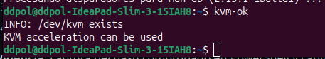
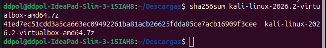
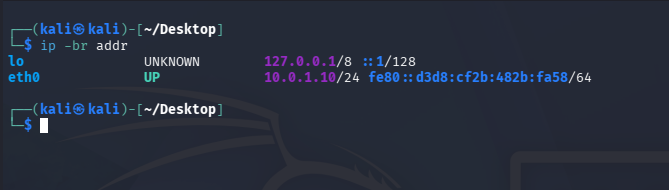
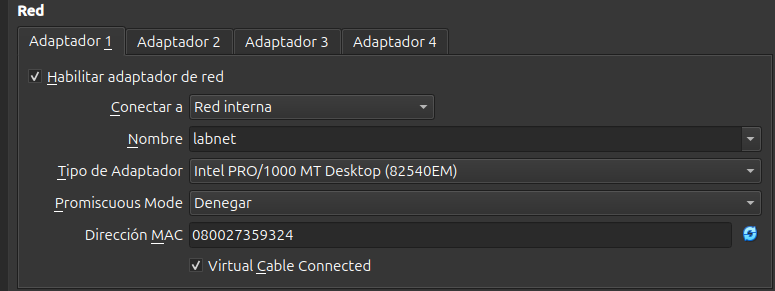
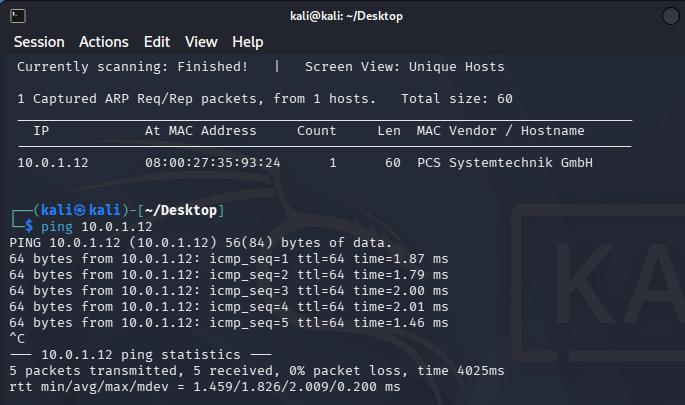
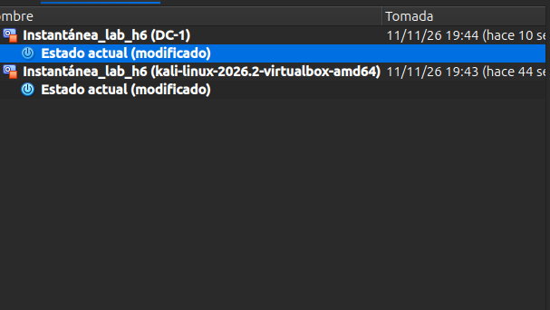

---

marp: true
theme: estilo
paginate: true
header: 'Monta tu propio laboratorio'
footer: 'Departamento técnico · Noviembre 2026'

---

<!-- _paginate: false -->
<!-- _header: '' -->
<!-- _footer: '' -->

# Monta tu laboratorio 
## Alejandro Heredia Mejias - Noviembre 2026

---

# H1

 
    

## Aqui podemos observar como la virtualización está activa usando las herramientas de cpu de linux

---

# H2

 
    

## En la primera imagen vemos el hash de kali linux

--- 

 
    

## Aquí obseervamos como cambiamos la contraseña de Kali Linux 

---

# H3

 
    

## Aquí podemos ver como la red está activa después de haber iniciado el servidor DHCP 
---

# H4

 
    

## Aquí podemos ver la información de la máquina DC-1

---

# H5

 
    

## Aquí vemos como usando netdiscovery, encontramos al sistema vulnerable dentro de la red interna y hacemos un ping para comprobar la conectividad 
---

# H6

 
    

## Aquí vemos como hemos echo instantáneas de las dos máquinas virtuales para conseguir recuperarlas en caso de romperlas 

---
# Ficha

### - ¿Por qué DC-1 no debe tener adaptador NAT ni puente?

###### DC-1 no debe tener esa clase de adaptadores debido a que como es una máquina vulnerable no debe tener ninguna clase de conexión a Internet debido a que sería un riesgo para el anfitrión.

### - ¿Para qué sirve el servidor DHCP que creaste en H3?

###### El servidor DHCP sirve para dar direcciones IP de forma automática en una red.

### - ¿Qué hacen netdiscover y ping, y qué información te dio cada uno?

###### Netdiscover nos busca que direcciones IP están siendo utilizadas en una red mientras que ping manda paquetes de prueba a una IP específica, netdiscover me dio cual es la IP de DC-1 y ping me confirmó que tengo conexión con el.

---

# IA

### A la hora de usar IA me he basado sobre todo en las traducciones de Windows a Linux debido a que este último es el sistema que yo utilizo para realizar las actividades.

### Me salia un error sobre que no podia crear la red DHCP, por lo que le pregunté a la IA la posible razón de esto y era porque me faltaba un paquete, aunque el comando estaba desactualizado lo pude solucionar con facilidad con un comentario al agente 